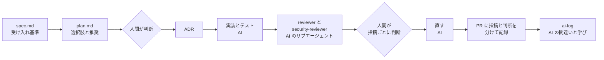
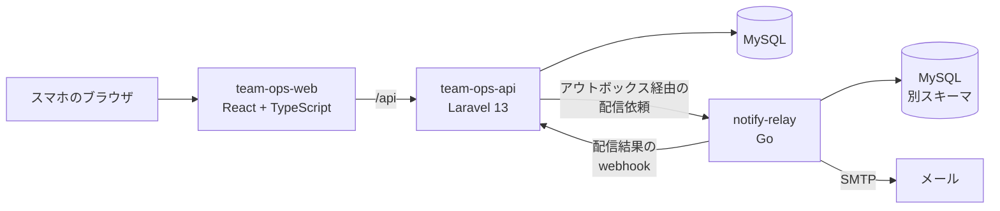

# team-ops

少年スポーツチーム(少年サッカーなど)の運営ツールです。保護者への連絡と名簿の管理を、スマホだけで回せるようにします。

Laravel・React・Go の4つのリポジトリで作り、**要件定義から公開・運用の準備まで、AI(Claude Code)と仕様駆動で進めた記録**をすべて公開しています。

> **現在の状況(2026年11月):第1弾の機能 001〜007 が完成。** 本番と同じ構成を CI で毎日起動して確かめており、いつでも公開できます(公開先は応募の時期に合わせて用意します)。負荷試験と障害訓練の振り返りは、次に追加します。

## 30秒で分かること

| | |
|---|---|
| **何を作ったか** | チームの作成と招待、名簿(CSV の一括登録)、役割と権限、お知らせ(予約送信)、既読と配信状況、未読の人への再通知、誰でも試せるデモモード |
| **どう作ったか** | 機能ごとに 受け入れ基準 → 計画(選択肢と推奨)→ 人間が判断 → ADR → 実装 → AI のレビュー → 人間が指摘ごとに判断、の順。[ADR 22本](docs/adr/)、[機能仕様 7本](specs/)、[AI 活用の記録 8本](docs/ai-log/) |
| **品質** | API の Feature テスト 531件(SQLite と MariaDB の両方)、画面のテスト 180件、Go のテスト、全サービスを通した E2E。テスト名に受け入れ基準の ID を入れて対応を追えるようにしています |
| **設計の芯** | 個人情報を「持たない」設計(ADR-0003)、他チームのデータは必ず 404(マルチテナント)、メール配信を Go に切り出して二重配信と取りこぼしを防ぐ(ADR-0002・0019) |
| **公開の準備** | FrankenPHP・Caddy・Docker Compose の本番構成、手順書、毎日の構成チェック(HTTPS で E2E、外に出ているのは Caddy だけ、バックアップから戻せる) |

## 画面

誰でもログインなしで試せる「デモモード」(spec 007)の画面です。役割を切り替えると、代表・コーチ・保護者それぞれの見え方を確かめられます。

| デモのログイン | チームのホーム(デモの帯) | 送信されたメール |
|---|---|---|
|  |  |  |

| お知らせの配信状況 | 名簿 | CSV の取り込み | 監査ログ |
|---|---|---|---|
|  |  |  |  |

機能ごとの画面は [team-ops-web/docs/screenshots](https://github.com/yuukioda999/team-ops-web/tree/main/docs/screenshots) にあります。

## AI 駆動開発の進め方

AI が実装・テスト・セルフレビューを行い、人間が判断とマージを行います([CLAUDE.md](CLAUDE.md))。



- **判断は人間**:AI は選択肢と推奨を示すところで止まります。たとえば 007 では、計画の判断6件とレビューの指摘21件を、人間が1つずつ決めています([007 の ai-log](docs/ai-log/2026-11-08-007-demo-mode.md))
- **AI の間違いを記録する**:どの ai-log にも「AI が間違えた点と学び」があります。例:メールの削除を「1回でうまくいく前提」で書いていた、ADR に検索できない列を条件として書いていた、ログの伏せ字でリクエストの側しか見ていなかった
- **AI の指示を超えた判断も人間**:公開の準備では、AI は VPS の契約を前提に案内していました。人間が「VPS は必須か」と問い直したことで、先に README と試験を進める判断になりました([公開の準備の ai-log](docs/ai-log/2026-11-08-deploy-preparation.md))

## 見どころ(どこを見れば何が分かるか)

| 見てほしい点 | 場所 |
|---|---|
| 要件から仕様への落とし込み | [立ち上げ依頼](docs/requirements/project-brief.md) → [001 の仕様(受け入れ基準)](specs/001-account-and-team/spec.md) → [計画と判断](specs/001-account-and-team/plan.md) → [作業分解](specs/001-account-and-team/tasks.md) |
| 設計判断の記録 | [ADR 一覧](docs/adr/)。例:[Go への配信の切り出し](docs/adr/0002-extract-delivery-to-go.md)、[個人情報を持たない設計](docs/adr/0003-minimize-personal-data.md)、[デモモード](docs/adr/0021-demo-mode.md)、[公開の方法](docs/adr/0022-demo-server-and-deploy.md) |
| AI の使い方と人間の判断 | [ai-log](docs/ai-log/)。各 PR にも「AI レビューの指摘」と「人間の判断」を分けて記録しています |
| 受け入れ基準とテストの対応 | テスト名に受け入れ基準の ID を入れています。例:[デモモードのテスト](https://github.com/yuukioda999/team-ops-api/tree/main/tests/Feature/Demo)、[他チームのデータは 404](https://github.com/yuukioda999/team-ops-api/blob/main/tests/Tenancy/TeamIsolationTest.php) |
| 全サービスを通したテスト | [E2E(Playwright)](e2e/tests/)。CI の [smoke](.github/workflows/smoke.yml) が docker compose の環境に対して毎回動かします |
| Laravel の作り | Controller → UseCase → Model の層分け、Policy による権限、[アウトボックスと配信の依頼](https://github.com/yuukioda999/team-ops-api/tree/main/app/Support/NotifyRelay)、[配信結果の webhook の受け取りと照合](https://github.com/yuukioda999/team-ops-api/tree/main/app/UseCases/Notices) |
| Go の作り | [notify-relay](https://github.com/yuukioda999/notify-relay):domain・usecase・adapter・infra の層分け、同時に送る数の上限、再送、[重複防止とデッドロック時のやり直し](https://github.com/yuukioda999/notify-relay/blob/main/internal/infra/mysqlstore/store.go)、結果の webhook のまとめ送り |
| 公開と運用の準備 | [本番の構成](deploy/)、[手順書](docs/runbook/)、[毎日の構成チェック](.github/workflows/deploy-check.yml) |

## 構成



| リポジトリ | 技術 | 役割 |
|---|---|---|
| **team-ops**(このリポジトリ) | Docker Compose | 開発環境、本番の構成、システム全体の資料、E2E |
| [team-ops-api](https://github.com/yuukioda999/team-ops-api) | Laravel 13 | 唯一の窓口。認証・権限・マルチテナント・業務ロジック |
| [team-ops-web](https://github.com/yuukioda999/team-ops-web) | React + TypeScript | スマホ向けの Web 画面。API の型は OpenAPI から生成 |
| [notify-relay](https://github.com/yuukioda999/notify-relay) | Go 1.26 | メール配信サービス(OSS)。業務ロジックを持たない |

画面は Go を呼ばず、Go は Laravel の DB を読みません(ADR-0004)。

## ローカルでの起動

4つのリポジトリを同じフォルダに並べて、team-ops から起動します。

```sh
git clone https://github.com/yuukioda999/team-ops.git
cd team-ops
make setup   # 残り3つのリポジトリを隣に clone
make up      # 全サービスを起動(初回は数分かかる。make ps で api が healthy になれば使える)
```

| 画面 | URL |
|---|---|
| Web | http://localhost:5173 |
| Mailpit(届いたメール) | http://localhost:8025 |
| API | http://localhost:8000/api/health |

### デモモードで試す(おすすめ)

`env/api.env` の `DEMO_MODE=false` を `true` にして、API を起動し直します。

```sh
docker compose up -d --force-recreate api api-worker api-scheduler
```

http://localhost:5173 を開くと「デモとしてログイン」が出ます。架空のチーム(選手20人、保護者20人など)が自動で作られ、役割を切り替えながら全機能を試せます。

### メールアドレスでログインする

ローカルは実在のアドレスにメールを送りません。宛先は `.invalid` で終わるアドレスだけで、すべて Mailpit に届きます(`.invalid` は実在しないことが決まっている予約済みのドメインです)。

1. http://localhost:5173 で `coach@example.invalid` などを入力し、「ログイン用のリンクを送る」を押す
2. http://localhost:8025(Mailpit)で届いたメールのリンクを開き、「ログインする」を押す

### テスト

```sh
make test   # API、Web、notify-relay
make e2e    # 起動中の環境に対して、ブラウザで全機能の流れを確かめる(Node.js が必要)
```

障害訓練用に `make chaos-smtp`(SMTP エラーを起こす)と `make chaos-relay-down`(配信サービスを止める)があります。`make help` でコマンドの一覧を表示します。

## 公開について

公開の準備はできています([ADR-0022](docs/adr/0022-demo-server-and-deploy.md))。

- **構成**:VPS 1台に Docker Compose。Caddy(HTTPS)→ nginx(画面)→ FrankenPHP(API)、キューの処理、定期処理、notify-relay、MySQL、Mailpit(デモのメールを受け止める)、Grafana Alloy(監視)
- **毎日の確認**:[deploy-check](.github/workflows/deploy-check.yml) が4つのリポジトリの main から本番と同じイメージを作り、次を確かめます
  - 外から HTTPS でデモモードの E2E が通る
  - 外に出ているのが Caddy だけ
  - ログにセッションの Cookie が出ない
  - 偽の IP が無視される
  - バックアップから戻せる
- **手順書**:[docs/runbook/](docs/runbook/) に、初期設定から公開、デプロイと戻し方、バックアップ、監視、証明書、困ったときをまとめています

## 資料

| 種類 | 場所 |
|---|---|
| 要件・立ち上げ依頼 | [docs/requirements/](docs/requirements/) |
| 設計判断の記録(ADR) | [docs/adr/](docs/adr/) |
| 機能仕様(受け入れ基準付き) | [specs/](specs/) |
| AI 活用の記録 | [docs/ai-log/](docs/ai-log/) |
| 運用の手順書 | [docs/runbook/](docs/runbook/) |
| 構成・設計 | [docs/design/](docs/design/) |

## ライセンス

[MIT](LICENSE)
