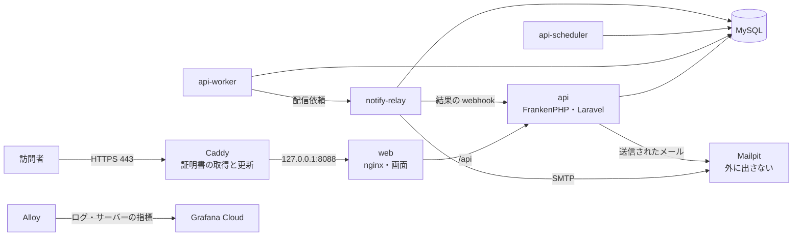

# デモ環境の運用手順書

`https://demo.freie.jp` で公開するデモ環境(ADR-0021・ADR-0022)の手順です。サーバーは さくらのVPS 2GB(Ubuntu 24.04)1台です。

| 手順書 | いつ使うか |
|---|---|
| [setup.md](setup.md) | 最初の1回:サーバーの初期設定から公開まで |
| [deploy.md](deploy.md) | 新しい版を出すとき、前の版に戻すとき |
| [backup.md](backup.md) | 毎日のバックアップの設定と、戻し方 |
| [monitoring.md](monitoring.md) | Grafana Cloud への送信、死活監視、アラート |
| [certificates.md](certificates.md) | HTTPS の証明書(期限の確かめ方、気をつけること) |
| [troubleshooting.md](troubleshooting.md) | デモが開けない、メモリが足りないなど |

## 構成

- 外から届くのは Caddy の 80・443 と SSH(22)だけです。ほかはすべて Docker のネットワークの中にあります
- 設定ファイルは `deploy/` にあります。秘密情報はサーバー上の `deploy/.env`・`.env.api`・`.env.relay` にだけ置き、Git には入れません
- メールは外部に送りません。すべて Mailpit が受け止め、25時間で消えます

## 決まりごと

- サーバーで直接ファイルを書き換えたら、同じ変更をリポジトリにも入れる(サーバーだけの変更を残さない)。例外は `.env` 系の3ファイルだけ
- Caddy・MySQL・Mailpit・Alloy などのイメージの版は `compose.prod.yaml` で固定している。上げるときはリポジトリの変更(Dependabot の PR など)として行う
- 作業の前後で `docker compose -f compose.prod.yaml ps` を見て、すべて `running`(api は `healthy`)であることを確かめる
